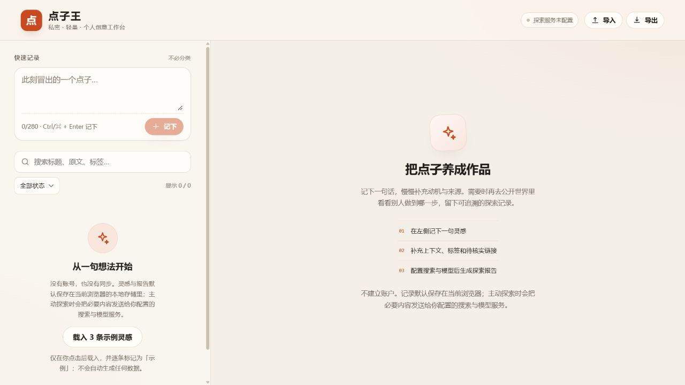

# 点子王使用指南 v0.0.1

这版最容易上手的用法，是先记下一条点子，打开详情补充想法，再试试搜索和备份。记录功能现在就能用。页面上显示“探索服务未配置”时，仍然可以完成下面的大部分操作。



## 打开点子王

当前已经启动时，直接打开 [点子王](http://localhost:3000)。以后如果页面打不开，在 Windows 的 PowerShell 中依次运行下面两行，看到 `Ready` 后再打开同一个网址。

```powershell
Set-Location -LiteralPath 'D:\点子王'
npm run dev
```

运行窗口需要保持打开。请一直使用 `localhost:3000`，并尽量用同一个浏览器。记录保存在这个浏览器的网站数据中，换浏览器或清除网站数据后，原来的记录不会自动出现。

## 用三分钟试一遍

1. 在左侧“此刻冒出的一个点子…”里写一句话，点击“记下”。无需先填分类。也可以按 `Ctrl + Enter`。
2. 点开新出现的卡片，在右侧修改标题，填写“补充说明”，再选择状态或创作动机。最初写下的那句话会留在“初始原文”里，修改标题不会覆盖它。
3. 刷新页面，刚才的记录应当还在。用左侧搜索框找标题、原文或标签；“全部状态”可以切换状态筛选。如果列表突然空了，先点“清除筛选”。

暂时想不到点子，可以点击“载入 3 条示例灵感”。这些卡片会标为“示例”。试完后点击“清除示例”，会先出现确认窗口。

## 整理自己的点子

在详情页可以添加标签，也可以贴一条小红书、B站等链接，留着以后核对。当前版本不会读取你贴的链接内容，所以它只是一条待核实线索。删除灵感会连同它的历史报告一起删除，点击“删除”后请看清确认窗口。

## 生成探索报告

“生成探索报告”按钮现在可能是灰色的。这表示搜索服务和模型服务还没有配置，记录功能照常可用。等配置好后，在详情页选择 B站、小红书、GitHub 等公开索引范围，再点击“生成探索报告”。一次探索可能需要约两分钟，期间保持页面打开。

报告会列出实际检索词、相关作品的来源链接、重合与差异、延伸方向和第一版建议。点开来源自行核对，系统目前只使用搜索索引提供的标题和摘要。如果当前范围没有找到可核实的作品，报告会明确写“当前范围未发现”，仍可给出基于点子本身的建议。生成过的报告会出现在详情页的“探索历史”里，可以按日期重新打开。报告上的“复制 Markdown”和“下载”可以把开发需求交给编程工具继续做。

要启用报告功能，需要在项目文件夹中把 `.env.example` 复制成 `.env.local`，填入你自己的 `TAVILY_API_KEY`、`AI_API_KEY` 和 `AI_MODEL`，然后重新启动点子王。具体字段见 [README](README.md)。密钥只填写在本机的 `.env.local`，不要发到聊天里。

## 备份和换浏览器

右上角“导出”会下载一份 JSON，里面包含当前浏览器里的灵感和报告。建议记录了一批重要点子后就导出一次。换浏览器时，先在旧浏览器导出，再在新浏览器点“导入”，选这个 JSON 文件。

导入默认选择“合并”，已有数据会保留，重复记录会跳过。“替换全部本地数据”会覆盖当前数据，只有确定要恢复整份备份时才选它。导入前先导出当前数据，可以给自己留一份退路。

## 目前需要知道的边界

点子默认只保存在当前浏览器。你主动生成探索报告时，必要的点子内容会发送给配置的模型服务，检索词会发送给搜索服务。报告依赖公开网页索引，找不到结果不代表全网没有类似作品。当前还没有账号同步功能。
